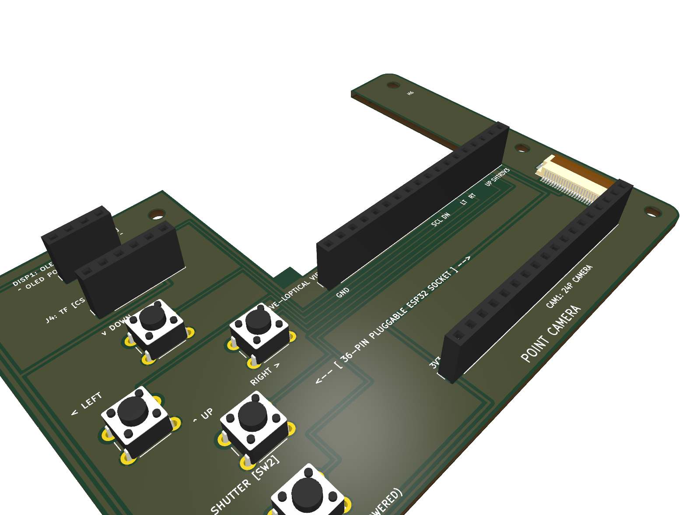
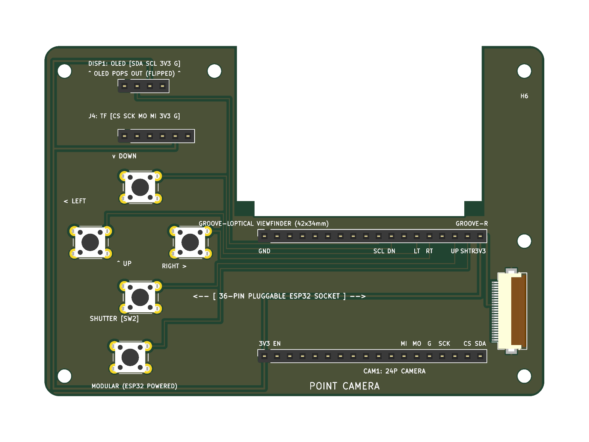
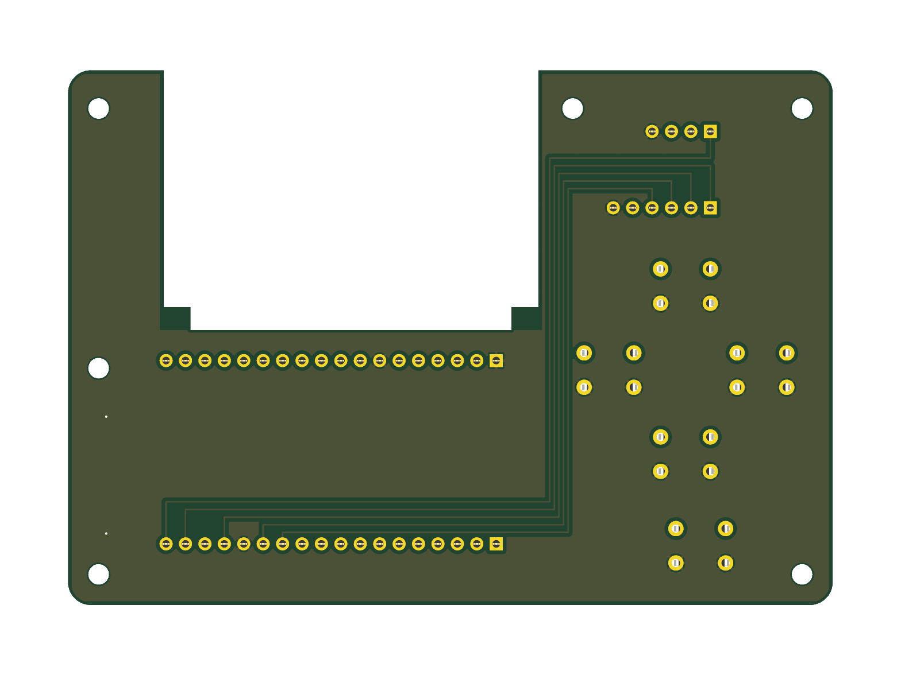

# DIY M2 RETRO DIGITAL CAMERA

**DIY M2 RETRO DIGITAL CAMERA** is an open-source, minimalist point-and-shoot camera inspired by bare-PCB, transparent retro cameras (such as the Paper Shoot and DIY M2). Engineered around the dual-core **ESP32** microcontroller, it features a 24-pin DVP CMOS image sensor, a high-contrast 0.96" OLED live HUD, a high-speed SPI MicroSD card slot, an ergonomic shoulder shutter button, a 4-way tactile D-Pad for real-time retro film filters, and innovative integrated side-wall slider grooves that allow a glass or acrylic viewfinder sheet to slide directly into the PCB!

When the **MODE** button is pressed, the camera cycles between 4 distinct photographic color profiles: **Natural (Normal)**, **Vivid Retro Warm**, **Monochrome B&W**, and **1970s Vintage Sepia**.

---

## Photos & Screenshots

### Isometric 3D View (Full Assembly)


### Top View (Silkscreen Pin Labels & Controls)


### Bottom View (Solid Ground Plane & Interconnects)


---

## How It Works

### How the parts fit on the camera

Every section of the carrier board is ergonomically laid out so that the bare PCB can be used directly as a standalone point-and-shoot camera without needing any 3D-printed enclosure:

1. **Center Viewfinder (Optical Aperture & Slider Grooves)**:
   - A $42.0 \times 34.0\text{ mm}$ clear rectangular optical aperture is centered on the PCB.
   - Recessed vertical guide channels (`GROOVE-L` at $X = 38.5\text{ mm}$ and `GROOVE-R` at $X = 87.5\text{ mm}$) are routed directly into the inner side walls of the PCB.
   - Solid $3.5\text{ mm}$ horizontal bottom stop shelves at $Y = 31.0\text{ mm}$ hold a clear glass or acrylic viewfinder sheet in place, sliding in directly from the top edge.

2. **Left Wing Core (Microcontroller & Power Bay)**:
   - An **ESP32 36-Pin Development Board (NodeMCU-32S / ESP-WROOM-32)** is mounted into female socket headers (`J_ESP_TOP` and `J_ESP_BOT`) with zero desoldering.
   - The ESP32's onboard USB-C / Micro-USB connector faces downwards at the bottom edge, allowing direct plug-in power from any portable 5V USB power bank.

3. **Top Shoulder (Ergonomic Shutter Button)**:
   - A tactile push button switch (`SW2`) is positioned at the top-left shoulder of the board ($X = 14.0\text{ mm}$, $Y = 7.0\text{ mm}$).
   - It connects directly between `GPIO 18` and ground using the ESP32's internal `INPUT_PULLUP` (zero external resistors!).

4. **Right Wing (Inverted OLED HUD & Storage Bay)**:
   - **Inverted 0.96" SSD1306 I2C OLED (`DISP1`)**: Mounted upside down with the display glass extending outward towards $Y = 0.0\text{ mm}$ to eliminate physical collisions with the adjacent SD module. Rendered right-side up in firmware via `display.setRotation(2);`.
   - **Reusable SPI MicroSD Module (`J4`)**: Plugs into a 6-pin female socket (`[CS, SCK, MOSI, MISO, 3.3V, GND]`) for tool-free MicroSD card swapping and photo saving under `/DCIM/IMG_xxxx.JPG`.

5. **Center Bottom (24-Pin DVP Camera Sensor)**:
   - A high-density **Hirose FH12-24S-0.5SH bottom-contact FPC connector (`CAM1`)** drives an **OV2640 (2 MP)** or **OV5640 (5 MP)** image sensor ribbon cable.

6. **Right Bottom (4-Way Navigation D-Pad)**:
   - A cluster of tactile buttons (`SW3` UP, `SW4` DOWN, `SW5` LEFT, `SW6` RIGHT) lets you cycle color profiles, adjust exposure compensation (EV), and open the photo playback gallery.

---

## Bill of Materials (BOM)

| Item | Qty | Supplier | Cost / Item (USD) | Total Cost (USD) | Link |
| :--- | :---: | :--- | :---: | :---: | :--- |
| **ESP32 36-Pin Development Board (NodeMCU-32S / ESP-WROOM-32)** | 1 | Robu.in | $5.35 | $5.35 | [Robu.in](https://robu.in/product/esp32-development-board/) |
| **0.96" I2C Monochrome OLED Display Module (SSD1306 128×64)** | 1 | Robu.in | $2.15 | $2.15 | [Robu.in](https://robu.in/product/0-96-inch-i2c-oled-display-module-blue/) |
| **SPI MicroSD (TF) Card Breakout Module** | 1 | Robu.in | $0.75 | $0.75 | [Robu.in](https://robu.in/product/micro-sd-card-module/) |
| **OV2640 2MP Camera Sensor Module (24-Pin 0.5mm Pitch DVP FPC)** | 1 | Robu.in | $4.85 | $4.85 | [Robu.in](https://robu.in/product/ov2640-camera-module-with-adapter-board/) |
| **16GB High-Speed MicroSD Card (FAT32 Class 10 / UHS-1)** | 1 | Robu.in | $3.90 | $3.90 | [Robu.in](https://robu.in/product/sandisk-ultra-16gb-microsdhc-uhs-i-card/) |
| **6×6×5mm Tactile Push Button Switches (Pack of 10)** | 1 | Robu.in | $0.23 | $0.23 | [Robu.in](https://robu.in/product/6x6x5-tactile-push-button-switch/) |
| **24-Pin 0.5mm Pitch Bottom-Contact FPC Connector (Hirose FH12-24S-0.5SH)** | 1 | LCSC | $0.45 | $0.45 | [LCSC](https://www.lcsc.com/product-detail/FFC-FPC-Connectors_Hirose-Electric-FH12-24S-0-5SH-55_C23912.html) |
| **2.54mm 1×40-Pin Female Single Row Header Strips (Pack of 10)** | 1 | Robu.in | $1.43 | $1.43 | [Robu.in](https://robu.in/product/2-54mm-1x40-pin-female-single-row-header-strip-pack-of-10/) |
| **M2.5 Brass Hex Standoffs & Screws Kit (Pack of 10)** | 1 | Robu.in | $0.95 | $0.95 | [Robu.in](https://robu.in/product/m2-5-brass-hex-threaded-pillar-standoff-spacers-pack-of-10/) |
| **Optical Glass / Clear Acrylic Viewfinder Sheet (48.5×32×1.5mm)** | 1 | Amazon | $0.80 | $0.80 | [Amazon](https://www.amazon.com/dp/B08P1X2XYZ) |
| **USB-A to Type-C / Micro-USB Shielded Data & Power Cable** | 1 | Robu.in | $0.70 | $0.70 | [Robu.in](https://robu.in/product/usb-2-0-type-a-to-micro-b-cable-1m/) |
| **Custom DIY M2 Camera Carrier PCB Manufacturing (5 pcs)** | 5 | JLCPCB | $1.48 | $7.40 | [JLCPCB](https://jlcpcb.com/) |
| **Total Project Cost** | **16** | — | — | **$28.96** | — |

*Downloadable spreadsheet format is available at [BOM.csv](BOM.csv).*

---

## How to Build

1. **Solder the Low-Profile Surface Mount FPC Connector**:
   - Align the 24-pin 0.5mm pitch `CAM1` connector onto the SMD pads at the bottom center of the board.
   - Solder using fine-tip soldering iron or solder paste and hot air.
2. **Solder the Tactile Push Buttons**:
   - Insert and solder the 5× 6×6×5mm tactile buttons: `SW2` (Shutter), `SW3` (UP), `SW4` (DOWN), `SW5` (LEFT), and `SW6` (RIGHT).
3. **Solder the Female Socket Headers**:
   - Solder the 2× 1×18 female socket headers for the ESP32 (`J_ESP_TOP` and `J_ESP_BOT`).
   - Solder the 1×4 female socket header for the OLED display (`DISP1`).
   - Solder the 1×6 female socket header for the MicroSD module (`J4`).
4. **Mount the M2.5 Brass Standoffs**:
   - Fasten the 6× M2.5 brass standoffs through mounting holes `H1` to `H6` to protect the PCB back and give it a firm grip.
5. **Slide in the Viewfinder Sheet**:
   - Slide the clear acrylic or glass sheet ($48.5 \times 32 \times 1.5\text{ mm}$) into the left and right side-wall grooves (`GROOVE-L` and `GROOVE-R`) until it rests on the bottom stop shelves.
6. **Plug In the Modular Breakout Boards**:
   - Insert the ESP32 board into `J_ESP_TOP` and `J_ESP_BOT`.
   - Plug the 0.96" SSD1306 OLED into `DISP1` (glass facing downward).
   - Plug the SPI MicroSD card module into `J4`.
   - Insert the 24-pin FPC camera ribbon into `CAM1` and lock the flip latch.
7. **Connect USB Power & Shoot**:
   - Plug any standard 5V USB power bank into the ESP32 USB port. Aim through the optical viewfinder and press the Shutter button!

---

## Software

The firmware supports both physical hardware and the Wokwi online web simulator.

### Arduino IDE Upload Instructions
1. Open the Arduino IDE (v2.0 or newer).
2. In **File > Preferences > Additional Boards Manager URLs**, add:
   ```
   https://raw.githubusercontent.com/espressif/arduino-esp32/gh-pages/package_esp32_index.json
   ```
3. In **Tools > Board > Boards Manager**, install `esp32` by Espressif (version 2.0.14 or later).
4. In **Sketch > Include Library > Manage Libraries...**, install:
   - `Adafruit SSD1306`
   - `Adafruit GFX Library`
5. Under **Tools**, configure:
   - **Board**: `ESP32 Dev Module`
   - **Partition Scheme**: `Huge APP (3MB No OTA/1MB SPIFFS)`
   - **CPU Frequency**: `240MHz`
6. Open the firmware sketch: [`esp32_camera_firmware.ino`](esp32_camera_firmware.ino).
7. Select your COM port and hit **Upload**!

---

## 💻 Wokwi Browser Simulation

Want to test the camera without physical hardware? You can simulate the entire circuit directly in your web browser using **[Wokwi](https://wokwi.com)**:
- Full wiring diagram, ESP32 MCU, 0.96" SSD1306 OLED, SPI MicroSD card, and 5 tactile push buttons.
- Test shutter clicks, live HUD updates, filter switching, and virtual SD card JPEG saving.
- Check out the **[`wokwi/` directory](wokwi/README.md)** for 3-step launch instructions!

---

## KiCad & Production Files

All hardware design files are verified with KiCad 10.0 and have achieved a verified **0 DRC violation, 0 unconnected item** score:

- **KiCad PCB Layout**: [diy_camera.kicad_pcb](diy_camera.kicad_pcb)
- **KiCad Project File**: [diy_camera.kicad_pro](diy_camera.kicad_pro)
- **KiCad Local Settings**: [diy_camera.kicad_prl](diy_camera.kicad_prl)
- **Fabrication Gerber Archive**: [gerbers/](gerbers/) *(RS-274X Gerbers & Excellon drill files)*
- **Bill of Materials Spreadsheet**: [BOM.csv](BOM.csv)
- **Bill of Materials Documentation**: [BOM.md](BOM.md)
- **KiCad DRC Verification Report**: [diy_camera-drc.rpt](diy_camera-drc.rpt) *(0 errors)*

---

## License

This project is licensed under the [MIT License](LICENSE) — free for maker builds, educational modifications, and commercial derivation with attribution.
